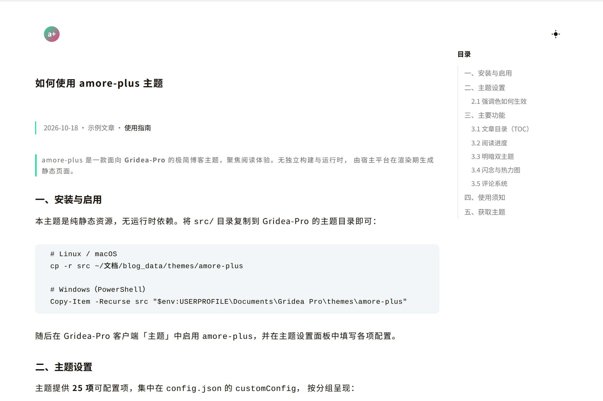

# amore-plus

> 极简博客主题 Gridea-Pro 版，聚焦阅读体验。支持明/暗双主题、文章目录、顶部阅读进度细线、闪念热力图与多评论系统（Giscus / Gitalk / Valine / Waline / Disqus）接入。



## 📖 两份文档，按需选择

| 你是 | 请看 |
|---|---|
| **想使用这个主题** | [**README.theme.md**](README.theme.md) —— 面向使用者的说明（安装、设置、功能、截图、授权）。提交到 [Gridea-Pro 官方主题仓库](https://github.com/Gridea-Pro/gridea-pro-themes)的版本即由此文件整理而来。 |
| **想参与开发** | 当前文件 —— 开发约定、目录结构、模板方言注意事项、验证方式 |

**在线演示**：<https://cocolight.github.io/amore-plus/demo/>（演示页本身是一篇《如何使用 amore-plus》的示例文章）

## 功能

- 首页：站点简介、头像/Logo、地理位置、格言、明/暗主题切换、社交链接与 RSS
- 内容页：博客列表、文章页，含**页面顶部阅读进度细线**与**文章目录（TOC）**
- 文章目录（TOC）：桌面端右侧 sticky 侧栏，由正文 `h2`/`h3` 自动生成锚点、滚动高亮当前章节；长目录时面板自动跟随；≤768px 隐藏
- 导航：归档、分类、标签、友链、关于、404
- 闪念（memos）：时间线列表 + GitHub 风格年热力图 + 客户端分页
- 主题：明/暗双主题（首次按 `defaultTheme`，之后记忆访客选择）、可配强调色
- 评论：Giscus / Gitalk / Valine / Waline / Disqus，由 `partials/comments.html` 按平台选择接入；闪念 / 友链 / 关于页不显示评论区
- SEO：`global-seo` / `index-seo` 片段；可选 Google Analytics
- 扩展：自定义 CSS / 自定义 JS

## 环境要求

- Gridea-Pro 客户端（本主题使用 Pongo2 / Django 风格模板方言，非标准 Jinja2）
- 无运行时依赖，主题为纯静态资源

## 安装

本主题为纯静态资源，无运行时依赖：

```bash
# 可选：本地做 HTML / 样式静态检查
npm install -g htmlhint prettier stylelint   # 或项目内用 npx 调用
```

## 运行

将 `src/` 整体放入宿主平台（Gridea-Pro）主题目录并启用：

```bash
cp -r src "<GRIDEA_HOME>/themes/amore-plus"
```

随后在 Gridea-Pro 客户端「主题」中启用 `amore-plus`，并在主题设置中填写 `src/config.json` 定义的各项（站点 Logo、地理位置、格言、社交链接等）。

## 测试 / 检查

主题本身无独立单元测试——模板由宿主平台在渲染期解析。

**注意**：本主题使用 **Pongo2（Django 风格）** 方言，纯 Python Jinja2 / htmlhint / prettier 等工具**无法**验证模板能否被 Gridea 正确解析（例：`{{ x|default:"" }}` 是合法方言，而 Jinja2 风格的 `{{ x|default('', true) }}` 会让整页渲染降级为「⚠️ 降级视图」）。

因此**唯一权威验证是 Gridea-Pro 重新构建后的产物**：

```bash
# 在 Gridea-Pro 中重新构建后，检查任一文章页
grep -c "降级视图" ~/文档/blog_data/output/post/<slug>/index.html   # 必须为 0
# 顺带核对主题特征元素是否齐全
grep -c 'mod-post__entry\|id="toc"\|reading-progress-bar\|data-repo=' \
  ~/文档/blog_data/output/post/<slug>/index.html
```

可选的静态格式检查（仅用于代码风格，不保证模板可解析）：

```bash
npx prettier --check 'src/**/*.{html,css,js}'
```

## 目录结构

- `src/` — 主题源码（模板 + 静态资源 + 设置定义）
  - `src/config.json` — 主题元信息与设置定义（名称/版本/作者/25 项 `customConfig`，含 9 项 Giscus 评论设置），是配置与版本号的唯一事实源
  - `src/templates/` — 页面模板（首页/博客/文章/归档/分类/标签/友链/关于/404/闪念），均 ``
  - `src/templates/partials/` — 复用片段：`head` / `header` / `footer` / `scripts` / `comments` / 各评论系统 / `global-seo` / `index-seo` / `reading-progress` 等
  - `src/assets/styles/` — `main.css`、`icons.css`、`lib/remixicon.woff2`
  - `src/assets/lib/` — 第三方脚本（vendored）`Valine.min.js`
  - `src/assets/media/images/` — `favicon.ico`、`avatar.jpg`、`zuobiao.svg`、`preview.png`
- `tests/` — 测试（当前为空；主题无独立单元测试，正确性由宿主平台渲染验证）
- `docs/` — 项目自己的文档（使用指南、参考、教程……）
- `docs/engineering/` — 模板预置的工程协作文档（架构 / 配置 / 完成定义 / 发版 / ADR）
- `scripts/` — 辅助脚本（当前为空）

## 开发约定

- 分支：`main` 为保护分支，功能走 `feature/<名称>`。
- 提交与本地检查：见 [CONTRIBUTING.md](CONTRIBUTING.md)。

## 许可证

本项目采用 MIT 许可证，详见 [LICENSE](LICENSE)。
